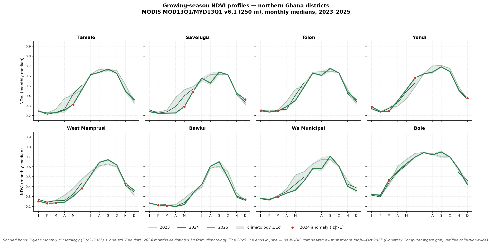
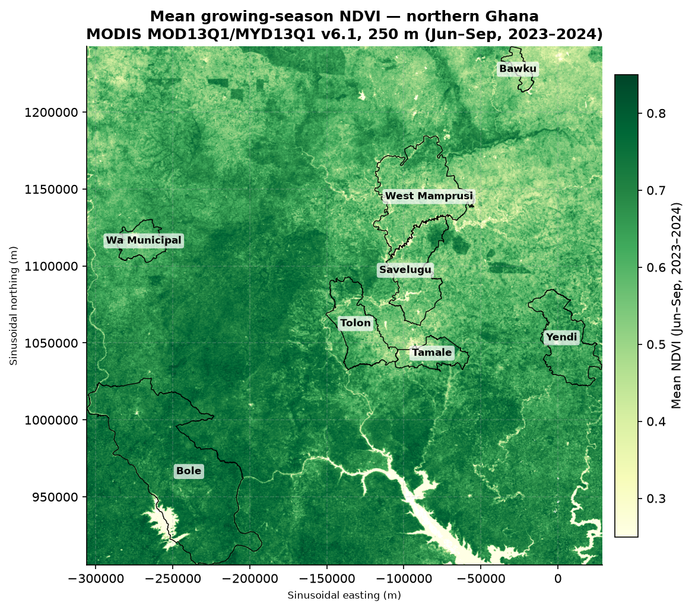

# Northern Ghana Crop-Season Monitor

Satellite NDVI monitoring of growing seasons across 8 agricultural districts in
northern Ghana, built from real MODIS observations. Monthly NDVI time series
(2023–2025), a 3-year climatology baseline, z-score anomaly detection for the
most recent season, and computed growing-season metrics (onset, peak, decay,
season integral).




## Why this exists

Northern Ghana has a single (unimodal) rainy season, roughly May–October, and
smallholder maize, millet, sorghum, and yam production tracks it closely.
A delayed onset or a mid-season dry spell shows up in vegetation greenness
weeks before it shows up in harvest reports. This project turns open satellite
data into an early, district-level view of how each growing season is
performing relative to recent history.

## Data

| Item | Source |
|---|---|
| NDVI + pixel reliability | MODIS MOD13Q1/MYD13Q1 Collection 6.1, 250 m 16-day vegetation indices, via the [Microsoft Planetary Computer STAC API](https://planetarycomputer.microsoft.com/api/stac/v1) (collection `modis-13Q1-061`). COGs read with windowed HTTP range requests; SAS-signed URLs, no API key needed. |
| District boundaries | [GADM v4.1](https://gadm.org), Ghana level 2 |
| Period | 2023-01 through 2025-12 (114 sixteen-day composites → 32 monthly medians; Jul–Oct 2025 missing upstream — see note below) |

**Processing choices (all documented in `src/`):**
- Cloud/snow masking via the `pixel_reliability` band: only values 0 (good) and
  1 (marginal) are kept; NDVI scaled by 0.0001.
- Monthly value = median of the month's 16-day composites (robust to residual
  cloud and Harmattan dust).
- Zonal statistic = spatial mean of monthly NDVI over each district polygon.
- Climatology = 2023–2025 monthly means; a short baseline, stated openly —
  anomalies are z-scores against it, flagged at |z| > 1.
- Season metrics are computed, not eyeballed: onset = first March–July month
  crossing 25% of the annual NDVI amplitude on a rising limb; peak = maximum
  within May–November; decay = last July–December month above the threshold;
  season integral = cumulative NDVI above the annual minimum between onset
  and decay.

## Results (2024 season vs. 2023–2025 climatology)

See `outputs/metrics.json` for the full per-district, per-year table
(onset/peak/decay months, peak NDVI, season integral). Headline numbers:

| District | 2024 onset | 2024 peak (NDVI) | 2024 season integral |
|---|---|---|---|
| Tamale | June | Sep — 0.671 | 2.24 |
| Savelugu | June | Sep — 0.640 | 2.03 |
| Tolon | May | Sep — 0.677 | 2.29 |
| Yendi | May | Sep — 0.692 | 2.54 |
| West Mamprusi | June | Sep — 0.671 | 2.01 |
| Bawku | June | Sep — 0.651 | 1.50 |
| Wa Municipal | June | Sep — 0.706 | 1.70 |
| Bole | March | Sep — 0.750 | 3.03 |

2025 (partial — onset only, season incomplete upstream): onsets detected
March–May across districts (Bole March; Savelugu, Yendi, Wa Municipal April;
Tamale, Tolon, West Mamprusi, Bawku May).

The seasonal-profile chart above shows every district: 2023–2025 monthly
curves, the climatology band, and red markers where 2024 deviated more than
one standard deviation from its climatological month.

> **Upstream data gap (documented, not hidden):** the Planetary Computer
> `modis-13Q1-061` collection contained no composites starting July–October
> 2025 at the time of access (verified collection-wide, not just over Ghana).
> 2024 is therefore the last *complete* growing season analyzed; 2025 yields
> onset timing only. The gap is recorded in `outputs/metrics.json`
> (`provenance.data_gap`).

## Reproduce

```bash
python -m venv .venv && source .venv/bin/activate
pip install -r requirements.txt
cd src
python 00_fetch_gadm.py  # district boundaries
python 01_inventory.py   # query the Planetary Computer STAC catalog
python 02_monthly.py     # fetch COG windows, mask, build monthly medians
python 03_analyze.py     # zonal stats, climatology, anomalies, metrics
python 04_plot.py        # figures + growing-season map
```

`02_monthly.py` is resumable (skips dates/months already on disk) and fetches
a fresh SAS token automatically. Expect the fetch step to take a while —
it pulls ~900 small windowed reads.

> Note: `src/cog_reader.py` reads COGs over HTTP range requests with
> `requests`+`tifffile` instead of GDAL's `/vsicurl/`, because the sandbox
> this was developed in breaks GDAL's TLS verification chain. On a normal
> machine, swapping in `rasterio.open(url)` works fine.

## Caveats

- MODIS 250 m pixels mix fields, fallow, and savanna — district means are a
  landscape signal, not a field-level yield proxy.
- The 3-year climatology is short; "anomaly" here means deviation from
  2023–2025, not from a 30-year normal.
- Harmattan dust (Dec–Feb) can depress NDVI independently of vegetation;
  the reliability mask removes the worst of it, not all of it.
- Flood-label-free zone: this repo monitors vegetation only — it does not
  claim flood detection (see `accra-flood-susceptibility` for that).

## License

MIT — see [LICENSE](LICENSE).
